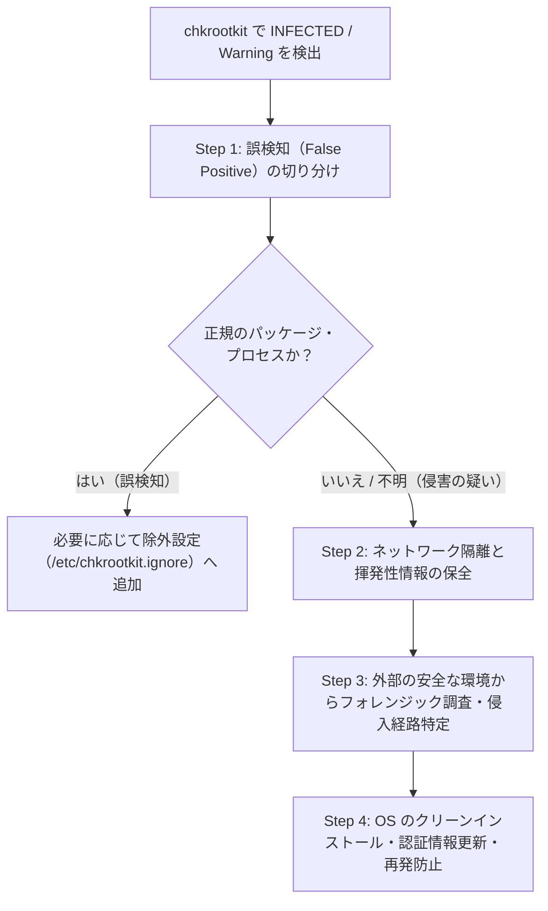

chkrootkit
===

## 概要

**chkrootkit (Check Rootkit)** は、Linux / Unix 系 OS にルートキットやバックドアが仕掛けられていないかをローカルで検査する、軽量かつ高速なオープンソースのセキュリティ診断ツールです。  
シェルスクリプト（メインの `chkrootkit`）と、システムコールやネットワークインターフェース・ログを直接検査する複数の C 言語バイナリツールで構成されています。

主な特徴と検査項目は以下の通りです。

- **システムバイナリの改ざん検出**: `ps`, `ls`, `netstat`, `ifconfig`, `login`, `sshd`, `top` などの主要コマンドに既知のルートキットのシグネチャが含まれていないかを検査
- **隠蔽プロセス・隠蔽ポートの検出**: `ps` コマンドの出力と `/proc` ファイルシステムの実態を比較し、LKM（Loadable Kernel Module）ルートキットによって隠蔽されたプロセスを検出（`chkproc`）
- **ネットワークインターフェースの盗聴検査**: ネットワークインターフェースがプロミスキャスモード（パケット盗聴状態）になっていないかを検査（`ifpromisc`）
- **システムログの改ざん検査**: `lastlog`, `wtmp`, `utmp` などのログイン履歴ログに不自然な削除・改ざん痕跡がないかを検査（`chklastlog`, `chkwtmp`）
- **既知のルートキット・ワーム・トロイの木馬の検出**: 70 種類以上の既知のルートキットおよびマルウェア固有のファイルや文字列を検査

:::tip[rkhunter との併用]
`chkrootkit` はシグネチャベースおよび `/proc`・ログの不整合チェックに特化しており高速に動作します。一方、[rkhunter](./rkhunter.md) はファイルハッシュ値による整合性チェックや設定監査に強みがあるため、両者を併用することで検知精度を高めることができます。
:::

---

## インストール

### Debian / Ubuntu

```bash title="apt でのインストール"
sudo apt update
sudo apt install -y chkrootkit
```

### RHEL / AlmaLinux / Rocky Linux / Fedora

RHEL 系ディストリビューションでは EPEL リポジトリにパッケージが含まれています（Fedora は標準リポジトリからインストール可能）。

```bash title="dnf でのインストール"
# RHEL / AlmaLinux / Rocky Linux の場合は事前に EPEL を有効化
sudo dnf install -y epel-release

# chkrootkit のインストール
sudo dnf install -y chkrootkit
```

---

## ファイル構成

パッケージからインストールした場合の主要なファイルとディレクトリの構成は以下の通りです。

| パス | 説明 |
| --- | --- |
| `/usr/sbin/chkrootkit` | chkrootkit のメイン実行スクリプト |
| `/usr/lib/chkrootkit/` | 内部で呼び出される検査用バイナリ群（`chkproc`, `ifpromisc`, `chkwtmp`, `strings-static` 等）※RHEL 系では `/usr/lib64/chkrootkit/` |
| `/etc/chkrootkit/chkrootkit.conf` | Debian / Ubuntu における定期実行・引数設定ファイル（旧バージョンでは `/etc/chkrootkit.conf`） |
| `/etc/chkrootkit.ignore` | Debian / Ubuntu で既知の誤検知（False Positive）出力を除外するための正規表現フィルタファイル |
| `/var/log/chkrootkit/` | 日次スキャン結果のログ格納ディレクトリ（Debian / Ubuntu） |

---

## 環境構築

chkrootkit はデータベースの事前作成なしでインストール直後からすぐ実行できますが、定期実行や信頼できるバイナリパスの指定を行う場合は以下の設定を確認します。

### 定期実行設定 (`/etc/chkrootkit/chkrootkit.conf`)

Debian / Ubuntu では `/etc/chkrootkit/chkrootkit.conf`（環境によっては `/etc/chkrootkit.conf`）で日次スキャンの有効化や実行時オプションを設定できます。

```ini title="/etc/chkrootkit/chkrootkit.conf"
# 日次 Cron スキャンを有効化する場合は "true" に設定
RUN_DAILY="true"

# 日次スキャン時のオプション（-q: 警告・感染疑いのみ出力）
RUN_DAILY_OPTS="-q"

# 前日のスキャン結果との差分のみを報告する場合は "true" に設定
DIFF_MODE="false"
```

### 誤検知の除外設定 (`/etc/chkrootkit.ignore`)

Linux の標準パッケージが `/lib` や `/usr/lib` 等に配置する正常なドットファイル（例: `.build-id` や設定ファイル）が `Suspect files` として報告されることがあります。  
Debian / Ubuntu パッケージ版の chkrootkit では、`/etc/chkrootkit.ignore` に正規表現（`grep -E` 形式）を記述することで既知の誤検知をフィルタリングできます。

```text title="/etc/chkrootkit.ignore"
# 正常なパッケージが生成するドットファイル・ディレクトリを除外する例
^/usr/lib/debug/\.build-id$
^/lib/modules/.*/vdso/\..*\.o\.cmd$
```

---

## 各種操作

:::note[実行権限について]
すべてのプロセス空間（`/proc`）やネットワークインターフェース、システムログを正確に検査するため、**`root` 権限（`sudo`）で実行** してください。
:::

### システムスキャンの実行

```bash title="システムスキャンの実行"
# システム全体を通常モードでスキャン
sudo chkrootkit

# クワイエットモード（INFECTED や Warning などの異常のみを表示）
sudo chkrootkit -q
```

### 主な実行オプション

| オプション | 説明 |
| --- | --- |
| `-q` | クワイエットモード（`not infected` や `nothing found` を省略し、警告・疑わしい項目のみ出力） |
| `-x` | エキスパートモード（バイナリ内の文字列解析など詳細な診断データを出力） |
| `-d` | デバッグモード（実行される各コマンドや処理過程をトレース出力） |
| `-r <dir>` | ルートディレクトリを指定してスキャン（マウントした外部ディスクやレスキュー環境からの検査に利用） |
| `-p <dir1:dir2>` | chkrootkit が内部で使用する外部コマンド（`awk`, `cut`, `find`, `egrep` 等）の安全な検索パスを指定 |
| `-n` | NFS マウントされたディレクトリをスキャン対象から除外 |
| `-T <fstype>` | 指定したファイルシステムタイプ（例: `tmpfs`, `squashfs`）を除外 |
| `-l` | 実行可能なすべてのテスト項目名を一覧表示 |

- 特定のテストのみを実行する例

    ```bash title="個別テストの実行"
    # 利用可能なテスト項目の一覧を確認
    sudo chkrootkit -l

    # sshd と ps、および LKM 隠蔽プロセス検査（lkm）のみをピンポイントで実行
    sudo chkrootkit sshd ps lkm
    ```

### スキャン結果のステータス表示

通常モードでスキャンを実行した際、各項目には以下のいずれかのステータスが表示されます。

| ステータス | 意味 |
| --- | --- |
| `not infected` / `nothing found` / `nothing deleted` | 異常なし（改ざんや感染の兆候は検出されなかった） |
| `not tested` / `not found` | 対象のコマンドやログファイルがシステム上に存在しないためスキップ |
| `Warning` / `Possible ...` | 疑わしいファイル（ドットファイル等）やプロセス、ポートが検出された（要確認） |
| `INFECTED` | ルートキットのシグネチャまたは改ざんが検出された（誤検知か実際の侵害かを直ちに調査） |

---

## 使用例

### 1. スキャン実行と検出項目の調査

1. **クワイエットモードでのスキャン実行**

    正常な項目を省略して注意が必要な出力のみを確認する場合は `-q` を使用します。

    ```bash title="異常項目のみを抽出してスキャン"
    sudo chkrootkit -q
    ```

    <details>
    <summary>スキャン出力例を表示</summary>

    ```text title="出力例"
    The following suspicious files and directories were found:
    /usr/lib/debug/.build-id
    /tmp/.XIM-unix
    /tmp/.font-unix

    eth0: PACKET SNIFFER(/usr/sbin/NetworkManager[812])
    ```

    </details>

2. **よく見られる警告（誤検知）の確認方法**

    - **`PACKET SNIFFER(...)` が表示された場合**:  
      DHCP クライアント、`NetworkManager`、`systemd-networkd`、`tcpdump`、`fail2ban`、または Docker / 仮想ブリッジなどがソケットを開いている場合に検出されます。表示されているプロセス名と PID が正規のシステムサービスであるかを確認します。
      ```bash title="対象プロセスの確認"
      ps -fp 812
      ```

    - **`The following suspicious files and directories were found` が表示された場合**:  
      `/usr/lib` や `/tmp` 配下の隠しファイル・ディレクトリが表示されます。どのパッケージに属するファイルかを `dpkg -S` または `rpm -qf` で確認します。
      ```bash title="ファイルの所属パッケージ確認"
      # Debian / Ubuntu の場合
      dpkg -S /usr/lib/debug/.build-id

      # RHEL / AlmaLinux / Rocky / Fedora の場合
      rpm -qf /usr/lib/debug/.build-id
      ```

### 2. 外部の安全なコマンド群とマウント環境を使ったフォレンジック検査

もし検査対象システムの `ps` や `ls`、`find` 自体がルートキットによって改ざんされている疑いがある場合、稼働中の OS 上のコマンドをそのまま使うとルートキットが自身を隠蔽する可能性があります。  
その場合は、レスキューメディア等から対象ディスクを `/mnt/target` にマウントし、`-r`（ルート指定）と `-p`（信頼できるバイナリパス指定）を組み合わせて検査します。

```bash title="外部マウントしたシステムの検査例"
# 信頼できるホスト側のコマンドパス (-p) を指定し、/mnt/target (-r) を検査
sudo chkrootkit -p /bin:/usr/bin:/sbin:/usr/sbin -r /mnt/target
```

### 3. Cron による定期スキャンとメール・ログ記録（RHEL 系など）

RHEL 系など標準で日次スクリプトが含まれない環境や、独自にログをアーカイブしたい場合は Cron スクリプトを作成します。

```bash title="/etc/cron.daily/chkrootkit-scan"
#!/bin/sh
set -eu

LOG_DIR="/var/log/chkrootkit"
DATE=$(date +%Y%m%d)
LOG_FILE="${LOG_DIR}/chkrootkit-${DATE}.log"

mkdir -p "${LOG_DIR}"
chmod 700 "${LOG_DIR}"

# クワイエットモードでスキャンを実行し、結果をログに保存
/usr/sbin/chkrootkit -q > "${LOG_FILE}" 2>&1 || true

# 30 日以上経過した古いログを削除
find "${LOG_DIR}" -type f -name "chkrootkit-*.log" -mtime +30 -delete
```

```bash title="実行権限の付与"
sudo chmod 750 /etc/cron.daily/chkrootkit-scan
```

---

## ルートキットと疑われるものが発見された場合の対処方法

スキャン結果に `INFECTED` や身に覚えのない `Warning` / `Possible LKM Trojan` 等が出力された場合、慌ててファイルを削除したりサーバーを再起動したりせず、以下の手順で段階的に切り分けと封じ込め・復旧を行います。



### Step 1: 誤検知（False Positive）か実際の侵害かの切り分け

まずはエキスパートモード（`-x`）やパッケージ管理ツールを用いて、検出された項目が OS の正規ファイル・プロセスによる誤検知か、実際の改ざんかを検証します。

1. **エキスパートモード（`-x`）とデバッグモード（`-d`）での詳細確認**

    `INFECTED` となった特定のテスト項目に対して `-x` や `-d` を付与して再実行し、どのファイルや文字列がシグネチャに一致したのかを確認します。

    ```bash title="特定のテスト項目を詳細モードで再検査（例: ps と lkm）"
    sudo chkrootkit -x -d ps lkm
    ```

2. **パッケージ管理システムによるバイナリ整合性の検証**

    システムコマンド（`ps`, `ls`, `sshd` 等）が `INFECTED` と報告された場合、ディストリビューションのパッケージデータベースが持つ正規のハッシュ値と一致するかを確認します。

    ```bash title="パッケージの改ざんチェック"
    # Debian / Ubuntu の場合（変更されたパッケージファイルを一覧表示）
    sudo dpkg -V
    # debsums が導入されている場合はより詳細なハッシュ検証が可能
    sudo debsums -c

    # RHEL / AlmaLinux / Rocky / Fedora の場合（例: /usr/bin/ps の検証）
    sudo rpm -Vf /usr/bin/ps
    # システム全体の全パッケージを検証する場合
    sudo rpm -Va
    ```

    :::note[`dpkg -V` / `rpm -V` の出力の見方]
    出力結果に `..5......`（MD5 ハッシュの不一致）や `S.5....T.`（ファイルサイズ・ハッシュ・タイムスタンプの不一致）がバイナリファイルに対して表示された場合は、パッケージ管理外でバイナリが書き換えられている可能性が極めて高い状態です。
    :::

3. **隠蔽プロセス（`chkproc` / `lkm`）や不審プロセスの検証**

    `Possible LKM Trojan installed` が出力された場合、スキャン実行の瞬間に終了した短命プロセス（ビルド処理やコンテナ等）とのタイミング競合による誤検知のケースがあります。`chkproc` を直接複数回実行し、恒常的に隠蔽プロセスが存在するかを確認します。

    ```bash title="chkproc バイナリによる隠蔽プロセスの直接確認"
    # Debian / Ubuntu の場合（RHEL 系は /usr/lib64/chkrootkit/chkproc）
    sudo /usr/lib/chkrootkit/chkproc -v -v
    ```

    特定の PID が報告された場合は、`/proc/<PID>/` から実行ファイルの実体や開いている通信ポートを確認します。

    ```bash title="不審な PID の実体調査（例: PID 12345）"
    # 実行ファイルへのシンボリックリンクと作業ディレクトリを確認
    sudo ls -l /proc/12345/exe /proc/12345/cwd

    # プロセスに紐づく環境変数や起動引数を確認
    sudo strings /proc/12345/environ
    sudo tr '\0' ' ' < /proc/12345/cmdline; echo

    # プロセスが開いているファイルとネットワーク接続を確認
    sudo lsof -p 12345
    ```

### Step 2: 侵害が疑われる場合の初動対応（封じ込めと証拠保全）

切り分けの結果、正規パッケージの改ざんや身に覚えのないバックドアプロセス・不審ファイルが確認された場合は、直ちにインシデント対応へ移行します。

:::danger[やってはいけないこと]
- **すぐに電源を切らない・再起動しない**: メモリ上にのみ展開されているマルウェア、実行中の不審プロセス、確立中の外部通信（C2 サーバーの IP アドレス等）などの揮発性データ（Volatile Data）が消滅し、原因究明が困難になります。また、再起動時にマルウェアの破壊スクリプトが動作するリスクもあります。
- **不審なファイルをその場で `rm` 削除しない**: タイムスタンプや侵入経路の手がかりが失われるだけでなく、ルートキットが常駐している場合は即座に再生成されます。
:::

1. **ネットワークからの即時隔離**

    外部への情報漏洩、他サーバーへの水平展開（ラテラルムーブメント）、および攻撃者による遠隔からの証拠隠滅を防ぐため、ネットワークを遮断します。
    - **物理サーバー**: LAN ケーブルを抜線する
    - **仮想環境 / クラウド**: ハイパーバイザーやクラウドコンソール側で仮想 NIC を切断するか、セキュリティグループ / ファイアウォールで全インバウンド・アウトバウンド通信を遮断する
    - **VM スナップショットの取得**: 仮想マシンやクラウドインスタンスの場合は、メモリ状態を含めたスナップショット（およびディスクイメージのクローン）をこの時点で取得し保全します。

2. **揮発性情報（メモリ・通信・プロセス状態）の保全**

    システムを停止する前に、稼働中でしか取得できない情報を外部ストレージや調査用端末へ保存します。

    ```bash title="揮発性情報の採取例（出力先は安全な外部マウント領域等を推奨）"
    mkdir -p /mnt/usb/forensics
    cd /mnt/usb/forensics

    # ネットワーク接続・待受ポートとプロセスの対応を記録
    sudo ss -tulpan > ss_tulpan.txt
    sudo ip addr > ip_addr.txt
    sudo ip route > ip_route.txt

    # 全プロセスツリーと開いているファイルを記録
    sudo ps auxfww > ps_auxfww.txt
    sudo lsof -nP > lsof.txt

    # ロードされているカーネルモジュール一覧を記録
    sudo lsmod > lsmod.txt

    # ログイン中ユーザーと直近のログイン履歴を記録
    w > w.txt
    last -Faiwx > last.txt
    ```

### Step 3: 信頼できる外部環境からのフォレンジック調査と侵入経路の特定

:::caution[侵害された OS 上のコマンドは信用しない]
ルートキット（特に LKM ルートキットや `LD_PRELOAD` 型・バイナリ置換型）が導入された環境では、稼働中の OS 上の `ps`, `ls`, `find`, `ss`, `netstat` 等を実行しても、**ルートキットによって攻撃者のプロセスやファイル・通信ポートが隠蔽された偽の結果** が返されます。
:::

正確な調査を行うため、対象サーバーをシャットダウンした上で、**レスキューメディア（Live USB / ISO）から起動するか、ディスク（またはスナップショットのボリューム）を別のクリーンな調査用マシンに読み取り専用でマウント** して検査します。

1. **読み取り専用マウントと外部からの再スキャン**

    ```bash title="調査用環境での読み取り専用マウントとスキャン"
    # 対象ディスクを読み取り専用 (ro)・プログラム実行禁止 (noexec) でマウント
    sudo mkdir -p /mnt/target
    sudo mount -o ro,noexec,nodev,nosuid /dev/sdb1 /mnt/target

    # クリーンなホスト側のコマンドパス (-p) を指定して対象ディスク (-r) を検査
    sudo chkrootkit -p /bin:/usr/bin:/sbin:/usr/sbin -r /mnt/target
    ```

    あわせて、[rkhunter](./rkhunter.md) や [ClamAV](./clamav.md) でも対象マウント領域（`/mnt/target`）をスキャンし、クロスチェックを行います。

2. **永続化（バックドア）箇所と侵入経路の調査**

    マウントした `/mnt/target` 配下のログおよび設定ファイルから、いつ・どの経路で侵入されたか、どこにバックドアが仕掛けられているかを調査します。

    | 調査対象 | 確認する主なパス（`/mnt/target` 配下） | 確認内容 |
    | --- | --- | --- |
    | **不正アカウント・権限昇格** | `etc/passwd`, `etc/shadow`, `etc/sudoers`, `etc/sudoers.d/` | UID `0` の不正ユーザー追加やパスワードハッシュ・sudo 権限の改ざんがないか |
    | **SSH バックドア** | `root/.ssh/authorized_keys`, `home/*/.ssh/authorized_keys`, `etc/ssh/sshd_config` | 攻撃者の SSH 公開鍵が追加されていないか |
    | **共有ライブラリプリロード** | `etc/ld.so.preload`, `etc/ld.so.conf.d/` | ユーザー空間ルートキットが使用する不正な `.so` ライブラリが指定されていないか |
    | **自動起動・定期実行** | `etc/crontab`, `etc/cron.*/*`, `var/spool/cron/`, `etc/systemd/system/`, `etc/rc.local` | マルウェアを再起動・再ダウンロードするジョブやサービスが登録されていないか |
    | **カーネルモジュール** | `lib/modules/`, `etc/modules`, `etc/modules-load.d/` | 不審な `.ko` ファイル（LKM ルートキット）が追加されていないか |
    | **最近変更されたファイル** | ファイルシステム全体 | 侵入推定時刻前後に作成・変更（ctime/mtime）されたファイルの洗い出し |
    | **システム・認証ログ** | `var/log/auth.log`, `var/log/secure`, `var/log/journal/`, Web サーバーログ | 不正ログイン、ブルートフォース、Web アプリケーションの脆弱性悪用痕跡の確認 |

    ```bash title="直近 7 日以内にステータス変更（ctime）されたファイルを検索する例"
    sudo find /mnt/target -xdev -ctime -7 -ls > /mnt/usb/forensics/recent_changed_files.txt
    ```

### Step 4: システムの復旧と再発防止

1. **OS のクリーンインストール（サーバーの再構築）**

    一度ルートキットを仕掛けられたシステムでは、検知できたファイルやプロセスを手動で削除しても、カーネル深部や別のシステムバイナリに未知のバックドアが残存している可能性を完全に排除できません。  
    そのため、**侵害された環境の修復・継続利用は行わず、必ず OS のクリーンインストール（またはクリーンなイメージからの新規インスタンス再構築）を実施** します。

2. **クリーンなバックアップからのデータ復元**

    - 侵入された日時よりも前の、改ざんされていないことが確実なバックアップからアプリケーションデータを復元します。
    - 復元するデータ（特に Web コンテンツの `.php` / `.py` / `.js` 等やスクリプト類）に Web シェルや不正コードが含まれていないか、展開前に必ず検証します。

3. **すべての認証情報・鍵の無効化と再発行（ローテーション）**

    侵害されたサーバー上に存在した（またはメモリ上を通過した）すべての認証情報は漏洩したものとみなして更新します。
    - 全 OS ユーザーのパスワード
    - SSH ホスト鍵およびユーザーの SSH 鍵ペア
    - データベースのパスワード、API キー、クラウド IAM のアクセスキー
    - TLS/SSL サーバー証明書の秘密鍵

4. **侵入原因の塞ぎ込みと監視強化**

    Step 3 で特定した侵入経路（古い公開アプリケーションの脆弱性、推測されやすい SSH パスワード、不要な公開ポートなど）の対策とパッチ適用を完了させてからネットワークへ再接続し、再稼働後も `chkrootkit` や `rkhunter` による定期監視を継続します。

---

## 参考

- [chkrootkit 公式サイト](https://www.chkrootkit.org/)
- [Debian Package Tracker - chkrootkit](https://tracker.debian.org/pkg/chkrootkit)
- [Ubuntu Manpage - chkrootkit(8)](https://manpages.ubuntu.com/manpages/noble/en/man8/chkrootkit.8.html)
